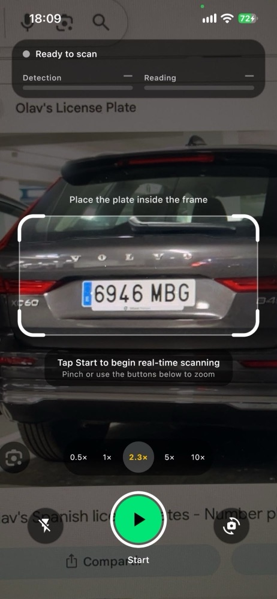
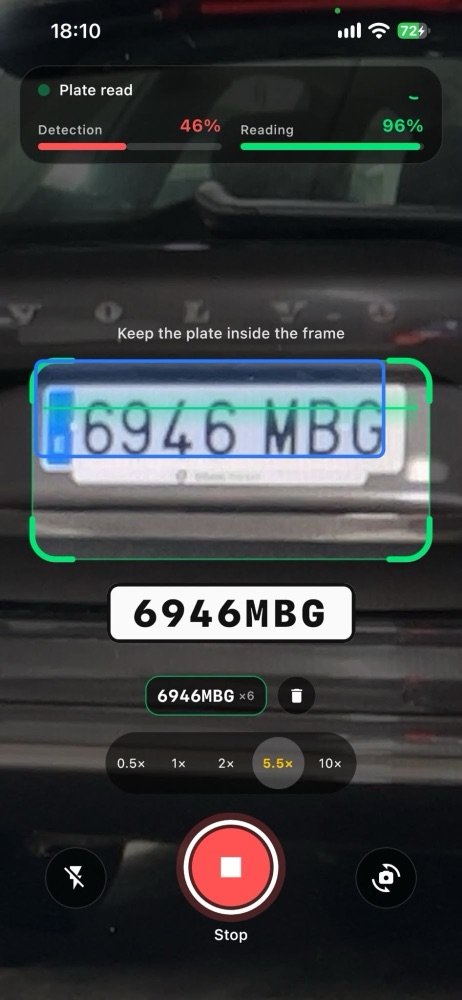
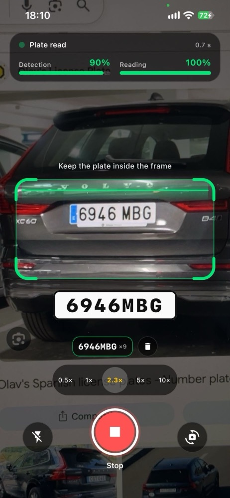
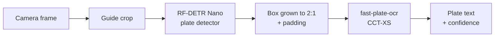
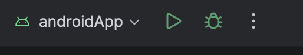
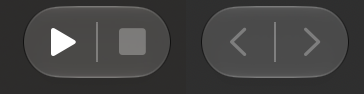

# Plate Scanner: on-device license plate reading for Android & iOS

Point the camera at a car and read its plate in real time, **100 % on the device**: no server, no cloud API, no
network. Two neural networks, one Kotlin Multiplatform codebase, the same `.tflite` files on both platforms.


<table>
  <tr>
    <td align="center"><br><sub>Ready: models loaded on device</sub></td>
    <td align="center"><br><sub>Detect: plate box inside the guide</sub></td>
    <td align="center"><br><sub>Read: text + confidence + history</sub></td>
  </tr>
</table>

<sub>Running on an iPhone. The plate photos on screen are from
<a href="https://www.olavsplates.com/spain.html">Olav's License Plates (Spain)</a>.</sub>

## Pipeline



1. **Camera.** Each frame is cropped to the guide rectangle on screen, at full resolution.
2. **Detector: RF-DETR Nano.** A transformer detector fine-tuned on one class, `license_plate`. It takes the crop at
   384×384 and returns the plate's box and a detection confidence.
3. **Crop.** The box is grown around its center to the 2:1 shape of a plate, plus a small margin, so characters at
   the sides that the detector left out are still in the crop.
4. **OCR: fast-plate-ocr CCT-XS.** A compact convolutional transformer fine-tuned on Colombian plates. It takes the
   plate at 64×128 and predicts its 10 character slots in a single pass, with a confidence per character.

The whole pipeline is shared Kotlin code; each platform only provides the TensorFlow Lite runtime and the camera.

## Training

Both models are fine-tuned in [**ocr_detector_vit**](https://github.com/freddmejia/ocr_detector_vit) and exported
to TensorFlow Lite with Jupyter notebooks:

| Model | Notebook | Fine-tuning |
|---|---|---|
| Detector | [`RFDETR_License_Plates.ipynb`](https://github.com/freddmejia/ocr_detector_vit/blob/main/notebooks/RFDETR_License_Plates.ipynb) | `Roboflow/rf-detr-nano` with Hugging Face Transformers on [justjuu/license-plate-detection](https://huggingface.co/datasets/justjuu/license-plate-detection), one class: `license_plate` |
| OCR | [`FastPlateOCR_Placas.ipynb`](https://github.com/freddmejia/ocr_detector_vit/blob/main/notebooks/FastPlateOCR_Placas.ipynb) | `cct_xs_v2_global` from [fast-plate-ocr](https://github.com/ankandrew/fast-plate-ocr) on Colombian plates ([jdbravo/plates-ocr-train](https://gitlab.com/jdbravo/plates-ocr-train)) |

## Stack

**Kotlin Multiplatform** · **TensorFlow Lite** · **AVFoundation**

## Try it on your phone

```bash
git clone https://github.com/freddmejia/ocr_detector_vit_kmp_app.git
```

<table>
  <tr>
    <th>Android</th>
    <th>iOS</th>
  </tr>
  <tr>
    <td>Open the project in Android Studio, plug in your phone and press Run.<br><br>
      </td>
    <td>Open <code>iosApp/iosApp.xcodeproj</code> in Xcode, pick your Team and your iPhone, press Run.<br><br>
      </td>
  </tr>
</table>

## Docs

| | |
|---|---|
| [Pipeline.md](shared/agents/Pipeline.md) | Model contract: tensors, preprocessing, cropping, decoding, validation tables |
| [Baseline.md](shared/agents/Baseline.md) | How a `.tflite` runs from a KMP module on Android and iOS |
| [Traceability.md](shared/agents/Traceability.md) | What was built, where, and how it was verified |
